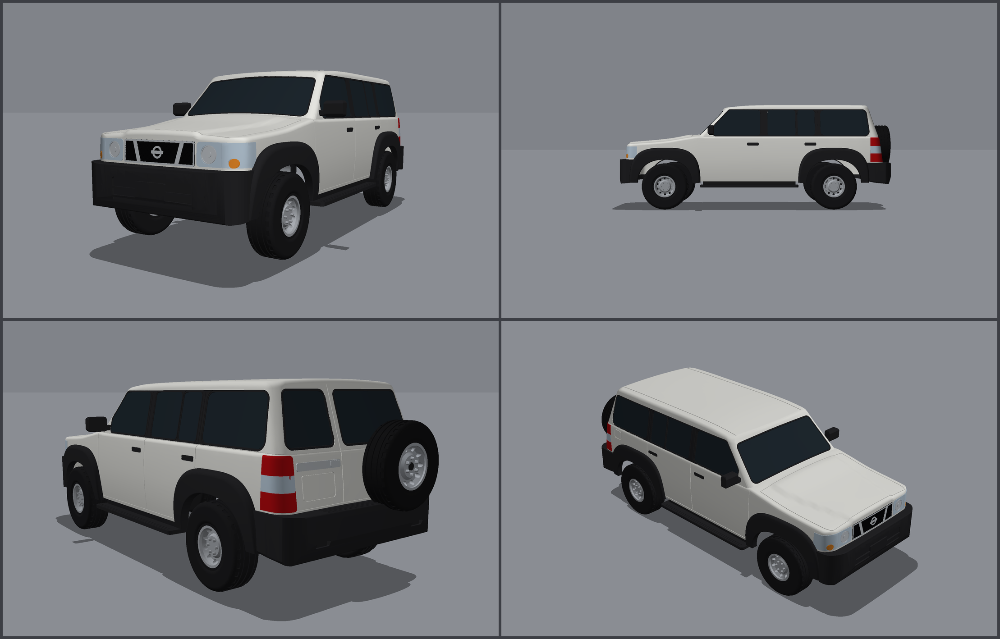
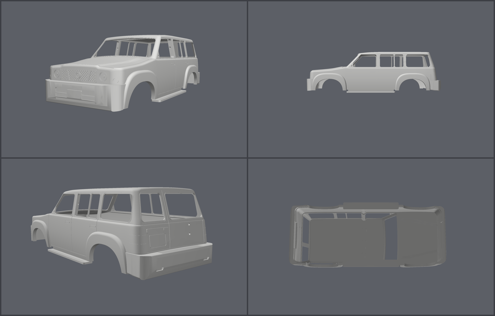
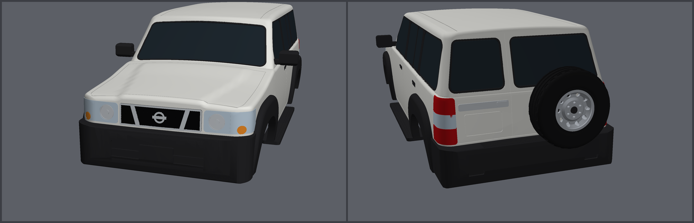
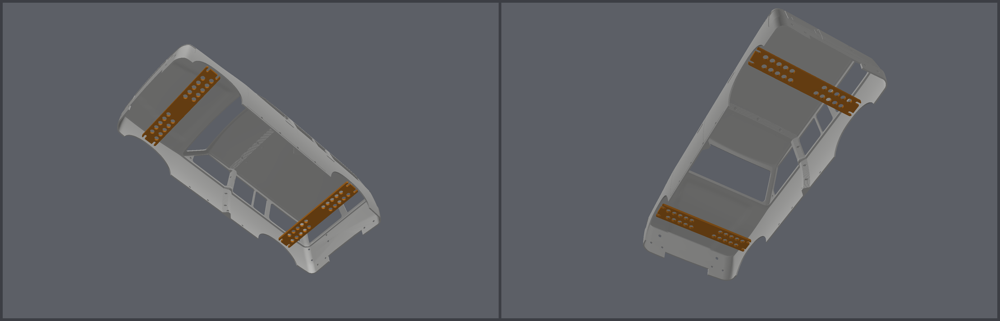

# Nissan Patrol Y61 GL (2007) – 1:18 RC body shell

A 3D-printable RC body shell of the 5-door Nissan Patrol Y61 (GU) in base **GL** trim:
black plastic bumpers, wide black arch flares, black side steps, steel wheels, tailgate-mounted
spare, no Super Safari accessories. STL files, millimetres, ready to slice.



The preview is the coloured model in `color/` (white body, charcoal trim, chrome grille), seen from
the same three viewpoints as the reference photos. The wheels under the body are placeholders –
your chassis supplies those.

## What this is, and what it is not

- The shape is **modelled from the reference photo and the published Y61 dimensions** – it is not
  a 3D scan. The side profile was fitted by overlaying the model on the side photo at the same
  scale: roof line, windscreen rake, bonnet line, belt line, window and pillar positions, tailgate
  lean, bumpers, flares and wheel arches all follow the photo. Plan-view shapes (how round the
  corners are, how far the flares stand out) are estimated from the three-quarter photos.
- It is a clean, simplified surface, not a sculpt: panel pressings, lamp internals and small trim
  are reduced to what prints at this size.
- Every STL was checked by the build script: one connected body, watertight, **zero non-manifold
  edges**, consistent winding, wall thickness sampled by ray casting.
- It has **not been test-printed**. Slice the body halves first and check the fit on your chassis
  before printing the rest.
- Left out on purpose at 1:18: lettering ("PATROL", badge text), wipers, antenna, interior
  (the shell is empty so the chassis, motor, battery and electronics have room).

## Scale and fitment

| | Model | Full size |
| --- | --- | --- |
| Scale | 1:18 | |
| Wheelbase | **165.0 mm** | 2970 mm |
| Length, bumper to bumper | 270 mm (278 mm with spare) | ~4860 / 5045 mm |
| Width, sheet metal / over flares / over side steps | 102.2 / 108.7 / 110.9 mm | 1840 / 1955 / ~2000 mm |
| Roof height above ground | 104 mm | 1875 mm |
| Inside width between the sills | 96.5 mm | |
| Wheel-arch opening | 55.6 mm wide, 26.8 mm above the axle centre | 1000 mm, as on the car |
| Tyre the arches are drawn for | up to **45 mm** diameter (stock is 43 mm) | 265/70R16, 777 mm |
| Tyre faces flush with the flares at | 109 mm outer track | |
| Wall thickness | 1.2 mm | |

**Arches and tyres.** The main files keep the wheel arches and flares exactly to scale, because
that is what makes it look like the car in the photo. Scale arches clear a tyre of up to about
45 mm at stock ride height, or about 51 mm with the body raised 4 mm on its posts. Most 1:18
crawler chassis run 55–58 mm tyres; for those use the files in `stl/big_tire_arches/` (arch
openings enlarged to 63 mm for a 57 mm tyre with a 4 mm lift – the flares get thinner, the rest
of the body is identical), or mount the scale body about 12 mm high and accept that the tyres
cannot tuck into the arches.

## Which files to print

**Just the body (one colour, paint the trim):**

| File | Size | Notes |
| --- | --- | --- |
| `stl/body_complete.stl` | 270 × 111 × 82 mm | Whole body in one piece: shell, bumpers, flares, side steps, grille, lamps fused. Needs a ~270 mm bed. |
| `stl/body_complete_front.stl` + `stl/body_complete_rear.stl` | 143 / 127 mm tall | The same body cut at the B-pillar. Fits a 180 mm printer. |
| `stl/big_tire_arches/body_complete*.stl` | same | The same three files with arches cut for 57 mm RC tyres. |

**Accessories** (`stl/accessories/`) – small parts that cannot sensibly be printed as part of the shell:

- `mirror_L/R` – door mirrors on a 1.9 mm peg
- `spare_tire`, `spare_wheel`, `spare_carrier` – tailgate spare (Y61 steel wheel: 6 studs, round vents)
- `glass_*` (9 parts) – optional window inserts with a glue flange, for clear PETG or resin
- `body_mount_crossbar_front/rear` – bolt-in crossbars with the body-post holes

**Multi-colour kit** (`stl/multicolor_kit/`) – the alternative to the fused body if you would rather
print the trim in black than paint it: bare `body_shell` (also as `_front` / `_rear` halves),
`bumper_front`, `bumper_rear`, four `flare_*`, two `side_step_*`, `grille`, `headlight_*`,
`taillight_*`, `tailgate_garnish`. Lamps, grille and garnish drop into 0.6 mm pockets; flares hook
over the arch edge; bumpers and steps take M2 self-tapping screws from inside or glue.

`manifest.json` lists every file with its size, volume and check results.

## Coloured model

STL cannot store colour, so the painted body is also exported in `color/`:

| File | Use |
| --- | --- |
| `patrol_y61_colored.glb` | View in any glTF viewer, phone AR viewers, Blender. Metres, Y up, smooth-shaded. |
| `patrol_y61_colored.obj` + `.mtl` | Universal fallback. Millimetres, Z up. |
| `patrol_y61_colored.3mf` | Multi-colour printing: opens in Bambu Studio / OrcaSlicer / PrusaSlicer as one object made of coloured parts, so you can assign a filament per part. |

Colours follow the reference photo: white body; charcoal bumpers, flares, side steps, mirrors,
door handles, window frames/pillars and glass rubbers; chrome grille surround, wing bars, badge,
headlight reflectors and tailgate garnish over a black mesh; amber indicators; red taillights with
the clear centre band; dark tinted glass; silver steel spare wheel. The black details on the shell
(`body_black_trim`) are cut out as their own volume, so they can be printed in black instead of
painted.

## Printing

- **Material:** PETG or ABS/ASA for a body that will roll over; PLA is fine for a shelf queen.
- **Layer / nozzle:** 0.12–0.16 mm layers, 0.4 mm nozzle. The 1.2 mm wall is three perimeters.
  Engraved panel lines are 0.4 mm wide × 0.3 mm deep.
- **Orientation:** files are exported in their intended print orientation.
  - Body halves stand on end (nose down / tail down). The fused halves rest on the bumper face and
    need short supports under the grille / tail panel; the bare-shell halves sit flat on the panel
    and need almost none. Seam ribs and mounting rails are chamfered at 45° so they print
    unsupported.
  - `body_complete.stl` is upright; print it with tree supports inside.
  - Bumpers and side steps are upside down, lamps/grille/glazing lie on their backs, mirrors on
    the glass face, flares on the back face (a few support lines under the leg tips).
- **Infill:** 10–15 % for bumpers, steps and the spare tyre (solid, chunky parts). Walls are solid.
- **Weight:** about 80–100 g printed for the fused body (115 cm³ of plastic if printed 100 % solid).

## Assembly

1. **Join the halves.** The seam has a rib on each side with M2 clearance holes. Glue the faces
   (CA or solvent) and pull them together with M2 × 8 screws and nuts, or just pins while the
   glue cures. The seam follows the shut line between the front and rear doors, so only the roof
   strip needs filling.
2. **Body mounts.** Inside each fender, just above the wheel arch, is a reinforced rail with M2
   pilot holes every 6 mm. Screw a crossbar up into the rails (M2 × 6 self-tapping) at the
   fore-aft position of your body posts. The crossbar has a staggered pattern of 4.4 mm post
   holes; the posts come up through them and standard body clips go on above the bar, reached
   through the wheel arch or a window. The bar underside sits 49 mm above the ground at scale
   ride height (60 mm on the big-tyre variant) – raise or lower the body by moving the clips on
   the posts.
3. **Chassis clearance.** The nose and tail panels have a 46 mm wide slot behind the bumpers for
   the chassis frame ends. Remove the chassis' own bumpers.
4. **Lights (optional).** Each headlight has a 3 mm LED socket behind the lens; each taillight has
   two 2 mm sockets. On the fused body the lens is a 0.6–0.9 mm skin over the socket – print in
   white/natural if you want it to glow.
5. **Trim.** Mirrors peg into the doors, the spare carrier screws to the tailgate (2 × M2 from
   inside), the wheel glues onto the carrier spigot inside the tyre. Glazing glues in from inside.
6. **Paint.** Body white; bumpers, flares, side steps, mirrors and door handles satin black;
   grille surround, wing bars and tailgate garnish chrome with a black mesh; wheels silver.

## Matching your chassis

Nothing above assumes a particular chassis, so **measure yours** – wheelbase, width across the
tyres, tyre diameter, body-post diameter and spacing – and regenerate if it differs:

```bash
cd generate
pip install -r requirements.txt

python3 build.py                                   # as supplied: true 1:18, scale arches
python3 build.py --tire-od 57 --lift 4             # arches enlarged for 57 mm tyres (big_tire_arches)
python3 build.py --wheelbase 155                   # shorter chassis: whole body scales to 1:19.2
python3 build.py --width-scale 1.12                # wider axles: stretch the body sideways only
python3 build.py --post-d 4 --post-spacing-front 40 --post-spacing-rear 44   # exact post holes
python3 build.py --scale 10                        # 1:10 class: 313 mm wheelbase, 2 mm wall, M3
```

`--wheelbase` keeps the car in proportion (everything scales together). `--width-scale` trades a
little accuracy for tyres that sit inside the flares. The script prints a warning if a tyre is too
big for the fender at the chosen lift, re-validates every part, and rewrites `stl/`, `color/`,
`preview/` and `manifest.json`.

## How the model is built

`generate/patrol_y61/` is a small Python package on top of
[manifold3d](https://github.com/elalish/manifold):

- `body.py` – the outer skin: a lower body lofted nose-to-tail (plan taper, barrelled flanks,
  crowned bonnet with its raised centre, rounded nose, forward-leaning tailgate) joined to a
  greenhouse lofted belt-to-roof (47° windscreen with plan bow, 12° tumblehome, 19° tailgate
  glass, roof crown).
- `model.py` – hollows the skin to a constant wall, then cuts arches, windows, panel lines and
  pockets, and builds flares, bumpers, steps, lamps, grille, mirrors, spare, seam ribs and mounts.
- `color.py` – the painted model: per-part colours, GLB / OBJ / 3MF writers.
- `build.py` – exports print-oriented STLs, checks them, renders the previews.

All vehicle dimensions in the source are full-size millimetres, so they can be corrected against a
real car in one place.




